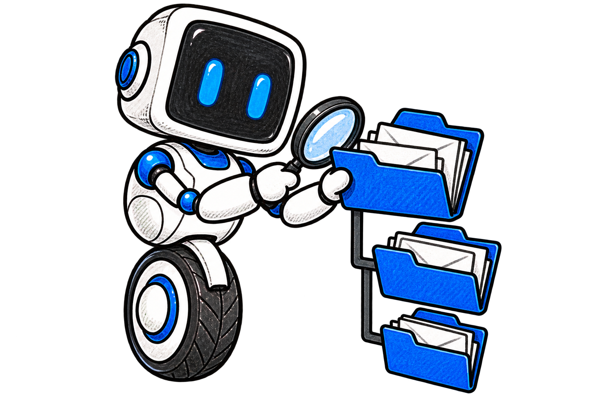

<p align="center"></p>
<p align="center"></p>

# AskMyDocs Gmail API connector

Read Gmail and Google Workspace mail into AskMyDocs using delegated read-only access, resumable acquisition and the shared email triage pipeline.

The Composer package is `padosoft/askmydocs-connector-gmail`; its connector key is `gmail`. It requires PHP 8.3+, Laravel 12 or 13 and connector-base 1.6+. The package owns OAuth, Gmail API transport, filtering, MIME decoding, attachments and synchronization. The host owns indexing, profiles, AI decisions, costs, snapshots, campaigns and access control.

## Install and first success

This is a local, unpublished package. Add a Composer **path** repository for your checkout and require its development branch; do not assume a remote release exists. In AskMyDocs, use the isolated host developer guide to install both local email packages. Laravel discovers `GmailServiceProvider` and the connector through Composer metadata.

```sh
composer config repositories.gmail path /absolute/path/askmydocs-connector-gmail
composer require padosoft/askmydocs-connector-gmail:dev-codex/gmail-api
php artisan vendor:publish --tag=connector-gmail-config
php artisan vendor:publish --tag=connector-gmail-assets
```

Configure these server-side environment variables, then open the host connector interface, install Gmail, complete consent and run health/discovery before choosing labels and syncing:

```dotenv
GMAIL_CLIENT_ID=your-web-application-client-id
GMAIL_CLIENT_SECRET=your-client-secret
GMAIL_REDIRECT_URI=your-exact-registered-callback
```

Enable Gmail API in Google Cloud, create a web application OAuth client and configure its consent screen. The redirect URI must exactly match the host callback. Herd uses `askmydocsdev.test` with its existing scheme. Google may reject a `.test` redirect in a web client; use an approved HTTPS callback proxy or registered test domain pointing to the same host route, preserving `APP_URL`. See [OAuth setup](docs/OAUTH.md).

## Select complete messages



Settings use native label IDs. An empty include list accepts all eligible messages, including archived mail. A nonempty list accepts **any** included label; any excluded label wins. Spam and Trash are excluded until explicitly enabled. A missing configured label causes an explicit error. Renaming a label schedules a resumable metadata refresh, while the message key, body revision and path stay stable.

Full `format=full` payloads supply plain/HTML bodies, headers and recursively nested MIME parts; snippets are never substituted for content. The renderer prefers plain text, sanitizes HTML into Markdown and optionally removes quoted lines. Sender/recipient address or domain filters, subject keywords, unread/starred selection, automatic-message exclusion and a UTC internal-date window complete provider selection locally. `sync_window_days=0` acquires all history.

Attachment policy defaults to 25 MiB per file, 20 accepted files, 50 MiB per message and inline exclusion. Supported extensions are declared in configuration; unsupported, inline, empty, MIME-mismatched, oversized and excess files stay visible as excluded manifest slots. Native attachment/part IDs distinguish same-name files. Nested RFC822 attachments are recorded as unsupported by default rather than fetched silently. No body resource URLs are downloaded.

## Resume acquisition


The first run captures a profile history anchor, scans pages and catches up history from that anchor before completing. History handles additions, deletions and label changes by rereading current message state. An expired history cursor starts a new bounded full scan; an incomplete scan never authorizes a prune. History IDs remain opaque strings.

State is isolated by tenant, installation and verified Google subject. `gmail_sync_state` is stored in the credential vault's extra state (tokens are encrypted); durable message receipts use the configured state disk. A shared atomic cache lock prevents overlapping syncs. Use a persistent shared cache and state disk in production. Run budgets cap pages, messages, requests, bytes and time; a paused result contains a safe resume notice, and subsequent sync calls continue its pending page. See [sync and recovery](docs/SYNC.md).

```php
use Padosoft\AskMyDocsConnectorGmail\GmailConnector;

$connector = app(GmailConnector::class);
$health = $connector->health($installationId);
$labelIds = $connector->listAvailableFolders($installationId);
$result = $connector->syncFull($installationId);
// Repeat incremental calls when result->hasErrors() reports a batch pause.
$result = $connector->syncIncremental($installationId, null);
```

`syncStatus($installationId)` reports started/complete/active/mode/phase without exposing a cursor or fetching mail. The host must set connector-base TenantContext before these installation-scoped calls. Health/discovery fetch no messages and do not alter cursor/configuration. OAuth refresh may rotate credentials. All mailbox requests are GET; local reconciliation is opt-in and uses the compound `email_message_key`. Disconnect clears local credentials/state without revoking a Google grant shared with another product.

## Hand off to the host


The package renders and applies host redaction, then emits `askmydocs.email.prepared.v1` synchronously **before any source write or dispatch**. The envelope commits the body hash and ordered attachment manifest. The host validates scope/revision and saves the manifest when triage is enabled. Listener, write or dispatch errors stop checkpoint advancement.

Body and attachments carry metadata email v1 and the same compound parent key; attachment receipts add native ID and slot. Default provenance is `untrusted-external`. A trusted internal override requires explicit installation configuration. OAuth and sender domains never imply trust. Original snapshots, triage opt-in, decision deduplication, ACL/versioning and campaign controls are supplied by the common host adapter; no AI executes during download. See [triage integration](docs/TRIAGE.md) and the [frozen standard](docs/specs/2026-10-14-email-api/STANDARD.md).

## Verify without a mailbox

```sh
composer install
composer validate --strict
vendor/bin/phpunit
vendor/bin/pint --test
vendor/bin/phpstan analyse --memory-limit=512M
```

Tests use synthetic messages, fake HTTP with `preventStrayRequests`, fake storage and synchronous listeners. CI covers Laravel 12/PHP 8.3 and Laravel 13/PHP 8.4+. Live Google consent, restricted-scope verification and real-mailbox performance require a separate operator-run test. See [CHANGELOG](CHANGELOG.md). Licensed under [Apache 2.0](LICENSE). Existing email illustrations are reused under the [recorded provenance](docs/readme/PROVENANCE.md).
